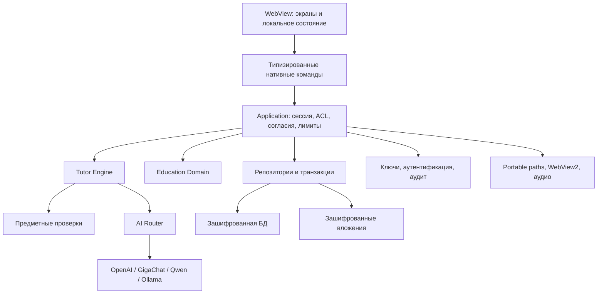

# Архитектура MVP — предложение для проверки

Дата: 25.10.2026. Статус: проект, не утверждённая реализация. Основание: ТЗ MVP 1.0. Предлагается модульный монолит: один desktop-процесс с WebView и нативными сервисами, без обязательного собственного удалённого backend. Удалённые сервисы — провайдеры ИИ и разрешённые источники справочной информации.

## Стек и границы

Кандидат: Tauri 2, Rust, TypeScript, SQLite с SQLCipher, Argon2id, XChaCha20-Poly1305. Конкретные версии и библиотеки выбираются при PoC по официальной документации и успешной Windows-сборке. Совместимость, лицензии и возможность упаковки ещё не проверены. Python-окружение текущей папки не определяет стек приложения.



UI получает только DTO разрешённых данных. В нём нет SQL, ключей БД, произвольных путей и прямых запросов к провайдерам. Допускается ввод API-ключа родителем в защищённую форму: однократная передача нативной команде, без хранения в состоянии приложения дольше операции, браузерных хранилищах и логах. Ответ команды возвращает маску и статус, без секрета. Полностью исключить временное присутствие вводимого секрета в памяти формы нельзя.

Предлагаемая структура после проверки стека:

```text
frontend/src/              экраны, компоненты, типизированный IPC-клиент
src-tauri/src/
  commands/                узкие команды и DTO
  application/             use cases, транзакционные границы
  domain/                  сущности и инварианты
  tutor/                   состояния, стратегии, подсказки
  providers/               контракт, router, четыре адаптера
  verification/            предметные проверки без произвольного исполнения
  persistence/             SQLCipher, репозитории, миграции
  security/                сессии, ключи, ACL, аудит, согласия
  platform/                пути, Windows runtime, STT/TTS
resources/catalog/         версионированный учебный каталог
tests/                     контрактные, интеграционные и приёмочные проверки
docs/                      требования, ADR, протоколы испытаний
```

## Доверие и авторизация

WebView, документы, сайты и ответы ИИ считаются недоверенными. Нативная сессия определяет действующего пользователя; поля `role` и `actor_id` из UI не дают полномочий. Каждая команда получает ресурс, проверяет сессию, актуальную подтверждённую связь родитель–ученик, семейную область и разрешение. Проверка и изменение критичных данных происходят в одной транзакции либо с проверкой версии записи.

Минимальный контракт команд: `register_student`, `register_parent`, `login`, `logout`, `recover_parent`, `request_link`, `confirm_link`, `reset_student_password`, `start_lesson`, `submit_answer`, `request_hint`, `pause_lesson`, `import_homework`, `confirm_recognition`, `save_provider`, `test_provider`, `approve_change`, `create_backup`, `restore_backup`. Это перечень use cases, сигнатуры определяются при реализации. Команды создания профиля и восстановления имеют собственную строго ограниченную политику доступа до входа.

Привязка: короткоживущий одноразовый криптографический токен; первый родитель связывается через подтверждение в аутентифицированном профиле ученика и родителя. Добавление второго требует подтверждения уже связанного родителя. Одного знания имени/ID недостаточно. Токены хранятся в виде проверочных данных, ограничиваются сроком и попытками, погашаются атомарно. Ученик без подтверждённой связи не запускает ИИ даже при наличии семейной конфигурации.

Для семейного провайдера и общих ограничений предлагается optimistic locking (`revision`): устаревшее изменение отклоняется с предложением перечитать настройки. Согласия меняются с журналом автора и времени. Отзыв согласия останавливает новые передачи, отменяет текущую по возможности и блокирует дальнейшие запросы. Уже переданные сервису данные отозвать технически невозможно.

## Ключи и вход до открытия базы

Для MVP предлагается один локальный семейный vault: несколько родителей и детей, одна зашифрованная БД. Независимые семьи в одной установке требуют отдельного решения о нескольких vault. ACL защищают через приложение; владелец извлечённого мастер-ключа технически может расшифровать всю БД вне приложения. Это ограничение общей БД, а не гарантия криптографической изоляции пользователей.

Полностью зашифрованная БД создаёт задачу загрузки до входа. Предлагается минимальный версионированный bootstrap-конверт в `app-data/secure/`: случайный ID vault, непрозрачные ID аккаунтов, соли/параметры KDF, зашифрованные обёртки мастер-ключа и параметры формата. Без открытых имён, школ, ролей, паролей, учебной истории и API-ключей. Выбор профиля до входа — по локальному идентификатору; открытый список имён потребует отдельного согласованного исключения по метаданным. После расшифровки конверт сверяется с пользователем и версией учётных данных в БД.

Предлагаемая схема:

1. Криптографический генератор создаёт случайный ключ данных. Пароль через Argon2id и уникальную соль даёт ключ обёртки; параметры версионируются и калибруются на целевом ПК.
2. Ключ данных защищается AEAD-обёрткой; связанные данные включают vault ID, account ID, назначение, версию. Отдельный материал применяется для вложений и секретов через документированное разделение ключей.
3. Каждый авторизованный пользователь имеет собственный способ разблокировки. Родителю дополнительно выдаётся высокоэнтропийный ключ восстановления; он защищает независимую обёртку. Сам ключ восстановления не хранится открыто.
4. Сброс пароля меняет обёртку, не шифрует всю историю заново. Связанный родитель создаёт новую обёртку ребёнку. Перевыпуск recovery удаляет активную старую обёртку и обновляет журнал.
5. Согласованность bootstrap и БД обеспечивается версионированным протоколом записи с журналом намерений и восстановлением после сбоя. Это отдельная проверка PoC; две независимые записи нельзя считать одной SQL-транзакцией.
6. Выход отменяет запросы, закрывает БД, очищает буферы секретов насколько допускают библиотеки и ОС. Кэш расшифрованных файлов не должен становиться постоянным открытым хранилищем.

Короткий PIN остаётся OPEN-03: прямой PIN→KDF→обёртка создаёт риск офлайн-перебора. До согласования безопасной схемы прототип использует полноценный пароль; PIN-требование не считается реализованным. DPAPI не может быть единственным способом восстановления переносимых данных.

Удаление связи/аккаунта запрещает последующий доступ через приложение, но не отзывает уже скопированные ключи или старые backup. Старый recovery-ключ также может открыть старую копию. Для отзыва доступа к текущему vault после компрометации нужна ротация ключа данных и соответствующих обёрток; детали ротации и сохранения доступности остальных пользователей — обязательный результат проектирования ключей перед реализацией AUTH.

## Данные и транзакции

В качестве схемы принимается перечень сущностей раздела 11 ТЗ. Добавляются технические поля/таблицы для версий настроек, одноразовых токенов связывания, idempotency keys, checkpoints и протокола ключевых обновлений. Каждое изменение схемы — миграция с номером, checksum и тестом обновления предыдущей поддерживаемой версии. FK включаются на каждом соединении, ограничения ролей/связей проверяются и доменом, и ограничениями там, где это выразимо.

Учебная сессия фиксирует снимок версии программы, учебника, темы, педагогической стратегии и идентификатора модели/подключения. Хранятся нормализованный результат проверки, уровень подсказки, неопределённость и фактический usage, без необходимости сохранять внутренние рассуждения модели. Удаление родительской связи не каскадирует в историю.

`submit_answer` имеет уникальный operation ID. В одной транзакции записываются взаимодействие, knowledge event, пересчёт knowledge state и checkpoint. Повтор с тем же ID возвращает сохранённый результат; тот же ID с другим содержимым отклоняется. Сетевой вызов не удерживает SQL-транзакцию. Результат отменённого/устаревшего запроса не применяется к новой версии задания.

Вложения: непредсказуемые ID вместо пользовательских путей, AEAD с уникальными nonce и проверкой тега, атомарная публикация файла, транзакционные метаданные и уборка незавершённых импортов. До разбора проверяются размер, тип по содержимому, число страниц/распакованный объём; DOCX не исполняет макросы. Распознавание и исходное изображение связаны; ошибка до подтверждения не меняет оценку знаний.

## Tutor Engine и проверка

Состояния: DIAGNOSE, EXPLAIN, DEMONSTRATE, PRACTICE, EVALUATE, HINT, REMEDIATE, REVIEW, SUMMARIZE, COMPLETE. Переходы определяет нативный движок по валидированному результату, а не произвольная команда модели. Пауза и незавершённость — статусы сессии вне педагогических состояний.

Пример пути: DIAGNOSE → EXPLAIN → DEMONSTRATE → PRACTICE → EVALUATE. Ошибка ведёт в HINT или REMEDIATE; успех — к практике/повторению/итогу. H5 запрещён на первой ошибке; доступность зависит от стратегии и зафиксированных предыдущих попыток. Модель не может повысить собственный уровень полномочий или выдать инструменту произвольный доступ к ОС.

Предметные инструменты возвращают `verified`, `incorrect` или `unknown` с областью применимости. На первом срезе — арифметика и подстановка в поддерживаемые уравнения; физика — разрешённые формулы и единицы; информатика — ограниченный статический анализ. Без доказанной изоляции пользовательский код не исполняется. `unknown` не повышает correct_count автоматически. Для H4/H5 вклад в mastery ниже самостоятельного ответа; конкретная формула, коэффициенты и пороги остаются проектным решением с тестовыми педагогическими примерами.

## Провайдеры и облачные данные

Общий контракт: `validate_configuration`, `list_models`, `get_capabilities`, `send_message`, `send_multimodal`, `stream_response`, `cancel_request`, `get_usage`. Неподдерживаемая операция возвращает явный typed result. Capabilities имеют источник и дату проверки; совместимость конкретных моделей не выводится из имени провайдера. GigaChat выделяет получение/обновление токена; Qwen имеет OpenAI-совместимый транспорт; Ollama изолирует локальные особенности. Точные endpoint и auth-потоки проверяются перед реализацией по документации провайдеров.

Перед каждым внешним запросом нативный router проверяет сессию, связь, лимит, разрешение на конкретный вид данных и возможности модели. Во внешний контекст попадают псевдоним, класс, предмет, тема и необходимые фрагменты задания; имя школы, адрес и семейные секреты не передаются по умолчанию. Нет автоматического переключения на другой облачный сервис при ошибке. Локальный Ollama имеет отдельную политику endpoint; удалённый адрес не считается локальным автоматически.

Ошибки: неверная конфигурация, авторизация, квота, сеть, timeout, неподдерживаемая возможность, некорректный ответ, отмена. Повторы ограничены и не дублируют учебные события; повторный вызов провайдера может расходовать токены. Usage неизвестного значения показывается как недоступный, а не нулевой. Стоимость не вычисляется без проверенных тарифов.

## Время, backup и Portable

В активном сеансе время считается монотонным таймером с периодическими checkpoint; переходы активности задаёт приложение по учебным действиям/паузе. Смена экранов сама по себе не обнуляет время. После лимита новые занятия блокируются; текущее задание может продолжаться до 15 минут, затем checkpoint и пауза. Правила idle, дневной границы и перезапуска требуют явной фиксации; попытки перевода часов между запусками журналируются и не должны молча сбрасывать расход. Полная защита от владельца ОС не обещается.

Backup содержит согласованный снимок зашифрованной БД, bootstrap-обёртки, зашифрованные вложения, версии схем/формата и манифест целостности. По умолчанию архив дополнительно защищён AEAD. Способ передачи/сохранения ключа архива определяется B04 так, чтобы восстановление после утраты установки не требовало только утраченного мастер-ключа. Без дополнительного слоя база и вложения остаются зашифрованы. Автокопирование проверяется на запуске и выполняется при доступности ключей и полномочий; отложенная операция становится видимой родителю после входа.

Restore: авторизация → проверка формата/целостности/размеров → расшифровка и миграция в staging → проверка доступности ключей и БД → закрытие текущей БД → безопасная замена с журналом и возможностью отката. Архивные пути не могут выходить за staging. Повреждение или сбой до завершения не уничтожает рабочий vault. Старые копии сохраняют старые данные и ключевые обёртки — удаление профиля из текущей БД не удаляет их автоматически.

`app-data/` определяется через расположение exe. WebView user data, cache, logs, staging и backup направляются внутрь него до создания WebView. Невозможность записи — явная ошибка без перехода в AppData пользователя. Системные временные исключения выявляются испытаниями; не объявляются соответствием заранее. Нужна проверка отсутствующего WebView2 до открытия окна с понятным нативным сообщением. Целостность шифрования включает проверку WAL, journal, временных файлов и аварийных дампов в доступных границах.

## Решения, требующие результата

| Вопрос ТЗ | Требуемое доказательство / решение |
|---|---|
| OPEN-01, OPEN-10 | Windows exe, отсутствие runtime, путь WebView и отсутствие скрытого постоянного хранилища |
| OPEN-02–04 | Спецификация bootstrap/ключей, recovery, crash safety, PIN, несколько родителей, отзыв и ротация |
| OPEN-05 | Русский STT/TTS на целевых ПК, отдельные согласия и текстовый fallback |
| OPEN-06 | Проверенные capabilities каждой выбранной модели и четыре живых текстовых теста |
| OPEN-07 | Измерения на минимальном целевом ПК и согласованные пороги |
| OPEN-08–09 | Лицензированные источники каталога/материалов и решение по данным детей до пилота |
| OPEN-11 | Семейная область, автор изменений, конфликты revision; предложение выше требует согласования |
| OPEN-12 | Новая оценка B01–B12 по фактическим результатам первых двух недель |
