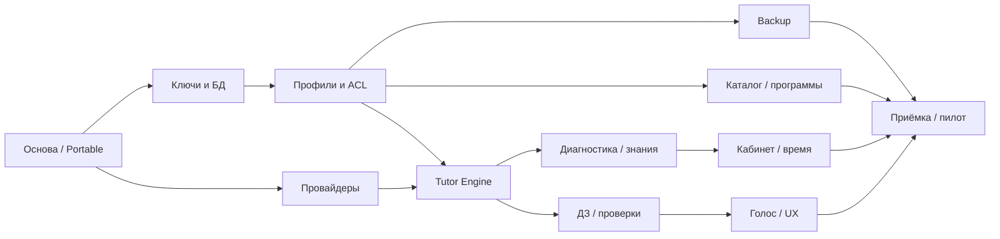

# Декомпозиция и план разработки

Статус: план для согласования, не обещание завершения всех P0 за 12 недель. Условие перехода от проектирования к основной реализации — результаты [PoC](poc.md). Все B01–B12 содержат обязательные работы; сокращение P0 оформляется новой версией объёма, а не скрытым переносом.

## Зависимости и этапы

Граф показывает основные зависимости, не исчерпывает связи. Профильный запуск ИИ требует B03, B05 и проверок времени из B10; эти проверки реализуются до учебного вертикального среза. Каталог B09 начинается раньше основного учебного этапа. Интерфейс разрабатывается с каждым сценарием, а не откладывается целиком до B11.

| Этап | Недели исходного плана | Проверяемый выход |
|---|---|---|
| Архитектурный прототип | 1–2 | B01, прототипы B02/B05, решение по ключам и переоценка срока |
| Пользователи и данные | 3–4 | B02–B04; ранние разрешения и лимиты; работающий вход/восстановление |
| Учебные модули | 5–7 | B05–B07, минимальный B09; сквозное занятие с сохранением |
| Персонализация | 8–9 | B08, B10; родительский отчёт из реальных учебных событий |
| Интеграции и интерфейс | 10–11 | Завершение B09/B11, весь реестр экранов и вводов |
| Приёмка и пилот | 12 | B12, AT-01–AT-38, исправления, сборка и протокол |

## Рабочие пакеты

### B01. Основа приложения и Portable

Зависимости: нет. Требования: ARCH, UI-001–002, PORT, NFR-MNT.

- Проверить инструменты сборки и стек, выбрать конкретные версии и библиотеку UI; сохранить lockfiles и команды воспроизводимой сборки.
- Подготовить оболочку, типизированные IPC-команды, обработку ошибок и нативный экран отсутствующего runtime.
- Реализовать единый path resolver, проверку записи и каталоги WebView.
- Разделить платформенные адаптеры; не создавать фиктивную Linux-поддержку.

Готово: exe запускается на чистом целевом Windows без установки самого приложения; AT-01, AT-02 и проверки PORT-009/010 воспроизводимы. Выбор стека оформлен ADR с артефактами испытаний.

### B02. Зашифрованное хранилище и ключи

Зависимости: B01. Требования: SEC, DB, AUTH-006/010/012, NFR-SEC.

- Специфицировать bootstrap, KDF/AEAD-параметры, обёртки, recovery, ротацию, несколько пользователей и протокол crash safety.
- Выбрать/испытать SQLCipher-сборку, миграции, вложения и очистку незавершённых файлов.
- Создать схему сущностей ТЗ; включить ограничения, версии, журнал безопасности и очистку логов.
- Согласовать PIN или зафиксировать нерешённость требования; не подменять короткий PIN паролем в статусе готовности.

Готово: бинарная проверка шифрования, неверные ключи отвергаются; смена пароля и recovery сохраняют данные; перенос без секретов исходной ОС; сбои между записями bootstrap/БД восстанавливаются. Результат PoC не является независимым криптографическим аудитом.

### B03. Профили, связи, права и согласия

Зависимости: B02. Требования: AUTH, ACL, AI-005–007, NFR-SEC-006/007.

- Реализовать регистрацию, вход/выход, блокировку, восстановление и сброс пароля ребёнка.
- Реализовать подтверждённую первую/вторую связь, токены, семейную область и конфликты общих настроек.
- В каждой нативной команде проверять пользователя и ресурс; тестировать подмену ID и устаревшую связь.
- Вести согласия по провайдеру и типу данных, аудит авторов и отдельную процедуру удаления профиля/материалов.

Готово: AT-03–09; прямой IPC-вызов запрещённых операций отвергается независимо от UI; учётка без родителя не вызывает ИИ; удаление связи сохраняет историю. Определены последствия удаления для backup.

### B04. Backup и восстановление

Зависимости: B02, B03. Требования: BKP, NFR-REL-001/002, DB-007.

- Описать формат архива, манифест, ключ дополнительного шифрования и восстановление после утраты исходного каталога.
- Делать согласованный снимок БД и вложений, ручную и ежедневную копию с отложенным запуском после авторизации.
- Проверять архив в staging; ограничить пути и распаковку, поддержать журнал замены и rollback.
- Показать историю, ошибки, настройку дополнительного шифрования и предупреждение перед отключением.

Готово: AT-32–35; неверный ключ, изменённый файл, несовместимая версия, недостаток места и остановка во время замены оставляют рабочую базу или восстанавливаемое прежнее состояние.

### B05. Провайдеры

Зависимости: B01; сохранение секретов — B02/B03. Требования: AI-001–011.

- Определить DTO, capabilities, нормализованные ошибки, usage, отмену и тайм-ауты.
- Реализовать четыре адаптера и токен GigaChat; настроечные команды доступны только родителям.
- Разделить контрактные offline-тесты и live-тесты с действующими учётными данными.
- Реализовать consent/capability gate перед отправкой, запрет молчаливого cloud fallback, redaction логов.

Готово: AT-10–15/38 на фактических моделях; отказ сети не повреждает историю; UI не получает секрет при чтении подключения. Макет ответа не засчитывается за live-проверку.

### B06. Tutor Engine и сквозное занятие

Зависимости: B03/B05, минимальные B09 и B10. Требования: TUT-001–007/009–011, EDU-011–013, DB-005.

- Создать автомат педагогических состояний, сценарии трёх режимов и политику H0–H5.
- Валидировать ответы ИИ и запросы инструментов, изолировать недоверенный контент.
- Сохранять snapshots, checkpoint, версии задания и idempotency keys; отбрасывать результаты отменённых запросов.
- Восстанавливать задание после навигации и перезапуска; завершать с итогом и событиями знаний.

Готово: AT-16/17 и тесты переходов/подсказок; первая ошибка не открывает H5; повтор ответа не удваивает результат; сбой провайдера не теряет сохранённое задание.

### B07. Проверка ДЗ и предметные инструменты

Зависимости: B06. Требования: HW, TUT-008–011.

- Реализовать безопасный импорт каждого формата HW-001, лимиты размера и разбор в ограниченной среде.
- Связать оригинал с распознаванием; дать исправить рукопись, формулы и неоднозначную тему до оценивания.
- Зафиксировать поддерживаемые классы задач и независимые инструменты математики/физики/информатики.
- Возвращать неопределённость за пределами инструментов; без изоляции выполнять только анализ кода.

Готово: AT-18–22 на эталонном корпусе, включая плохие фото и ошибки OCR; неподтверждённое распознавание не снижает mastery; инструкция из DOCX/PDF не меняет политику агента.

### B08. Диагностика и модель знаний

Зависимости: B06, каталог тем B09. Требования: ASM, KNW, PAR-001–004/007.

- Определить наблюдаемые evidence, формулу mastery/confidence/trend, шкалу сложности и влияние подсказок.
- Реализовать диагностику темы/предмета, обновление по обычным занятиям, повторение и рекомендации.
- Построить карту знаний и отчёты за неделю/месяц с объяснимыми основаниями.

Готово: AT-23–25; самостоятельный ответ и H4/H5 дают различный вклад; повтор события не меняет результат второй раз; мало данных отображается как неопределённость. Педагогические коэффициенты проверены на согласованных примерах, не объявлены доказанными измерителями знаний.

### B09. Каталог, школы и программы

Зависимости: B03; начальный локальный каталог возможен раньше. Требования: EDU-001–013, AUTH-002, PAR-005/010.

- Подготовить и лицензировать источники регионов/городов/школ с автодополнением; отдельно — каталог тем и учебников.
- Реализовать попытку определения программы по официальному источнику, дату/статус проверки и ручной fallback.
- Добавить запрос изменения учеником, подтверждение родителем и версии учебных назначений.
- EDU-014/015 оставить отдельной P1-задачей до решения планирования.

Готово: AT-26/37; все три предмета имеют пригодный для пилота каталог; неоднозначный результат не подменяет подтверждённую программу; история ссылается на прежнюю версию.

### B10. Родительский кабинет и лимиты

Зависимости: B03, затем B08. Требования: PAR, TIME, NFR-REL-004.

- Ранний срез: активный таймер, лимит, grace period до 15 минут, pause/checkpoint, хранение расхода и защита от повторных операций.
- До реализации зафиксировать idle-порог, действия, считающиеся активностью, дневную границу и реакцию на перевод часов/перезапуск.
- Завершить отчёты, переключение детей, управление программами, согласиями, провайдерами и безопасностью.

Готово: AT-25/27/28; монотонный таймер тестируется без ожидания реальных 15 минут; перевод часов в активном сеансе не продлевает доступ; другой родитель не теряет изменения из-за устаревшей формы.

### B11. Голос и завершение UI

Зависимости: B03/B05/B06/B07. Требования: UI, VOICE.

- Выбрать русский STT/TTS и условия локальной/облачной работы; установить отдельные consent gates для аудио.
- Добавить редактирование диктовки перед отправкой, независимые выключатели и текстовый fallback.
- Закрыть все UI-01–UI-20, KaTeX/аналог, графики, таблицы, изображения, темы по профилю и системные изменения.
- Проверить доступность клавиатурой, чтение ошибок, пустые/загрузочные/аварийные состояния, сохранение задания при навигации.

Готово: AT-29–31/38; отказ аудио не блокирует ввод текста; системная тема меняется без перезапуска; переход в настройки и обратно сохраняет задание.

### B12. Приёмка и пилот

Зависимости: B01–B11. Требования: все, NFR и раздел 20 ТЗ.

- Выполнить AT-01–AT-38, security/corruption/cancellation проверки и испытания Portable на чистых ПК.
- Измерить запуск, профиль, историю, карту знаний, первый ответ ИИ, изображение, backup/restore, CPU/RAM; отдельно записать сеть и характеристики ПК.
- Согласовать числовые пороги, закрыть блокирующие дефекты, сформировать checksum сборки, release notes и руководство восстановления.
- До пилота закрыть использование материалов и обработку данных детей; собрать обратную связь по педагогике отдельно.

Готово: доказательства приёмки доступны; нет известных критических дефектов потери данных, раскрытия секретов и обхода прав. Непройденный P0 означает незавершённый MVP.

## Правило завершения задачи

Код, миграции и контрактные изменения согласованы между собой; есть тест существенного поведения, понятный отказ, отсутствие открытых секретов и обновлённая документация. Результат обозначается одним из `planned`, `in_progress`, `blocked`, `passed`, `failed`, а не «готово» по наличию файлов. Сейчас все пакеты запланированы; приложение не реализовано.
